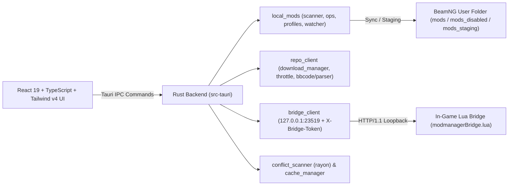

<div align="center">


# BeamNG.ModManager

**Desktop mod manager, profile switcher, and Official Repository client for BeamNG.drive.**

[](https://github.com/selowx/BeamNG.ModManager/releases/latest)
[](https://github.com/selowx/BeamNG.ModManager/releases)
[](https://tauri.app/)
[](https://react.dev/)
[](https://www.rust-lang.org/)

[Download](#installation) · [Features](#features) · [Architecture](#architecture) · [Repository Structure](#repository-structure) · [Build from Source](#development--build) · [Changelog](./CHANGELOG.md)

</div>

---

## Installation

1. Open the [GitHub Releases](https://github.com/selowx/BeamNG.ModManager/releases/latest) page.
2. Download the Windows installer (`BeamNG.ModManager_0.7.0_x64-setup.exe` or `.msi`) under **Assets**.
3. Run the installer and launch **BeamNG.ModManager** — your BeamNG.drive install and user mod paths are detected automatically.

> [!NOTE]
> The desktop application requires **Microsoft Edge WebView2 Runtime** (pre-installed on Windows 10/11). Existing `.zip` archives in `mods/` and `mods_disabled/` are detected without re-downloading.

---

## Features

| Module | Capabilities |
| :--- | :--- |
| **Installed Mods** | Manages `mods/` and `mods_disabled/` directories, `.zip` drag-and-drop installation, protection locks (`pinned`), bulk enable/disable, per-mod `tag_id` update checking, `Update All`, and `3s` filesystem signature polling (`local-mods-changed`). |
| **Profiles v2** | Switchable mod packs with `ModProfileRef` metadata, tag filters, `Strict` / `Keep Protected` pin policies, pre-apply diff preview, 1-step `Undo Last Switch` backup, live disk synchronization on active-profile edits, drift detection, missing-mod batch downloads, and JSON import/export. |
| **Download Manager** | Two-tier sidebar dock + slide-over drawer + cross-tab mini status strip. Supports `1–3` concurrent transfer slots, `HTTP Range` (`206`) pause/resume on `.part` files, token-bucket bandwidth throttling, ZIP magic-header checks, and automatic `mods_staging/` routing when BeamNG.drive is running. |
| **Official Repo & Lua Bridge** | Server-side `api.beamng.com` search with HTTP `429`/`503` backoff cooldown reporting and `repo_catalog.json` offline snapshot fallback, paired with the in-game Lua HTTP/1.1 bridge (`modmanagerBridge.lua` on `127.0.0.1:23519`) for authenticated browsing, subscriptions, and `/v1/reload` hot-reloading. |
| **Health & Conflict Scanner** | Parallel `.zip` archive inspection (`rayon`) detecting corrupted archives, duplicate mod IDs, and internal file-overwrite conflicts across installed mods. |
| **Settings & Launch Control** | Persisted `Steam` / `Direct (.exe)` game launch mode, Win32 clipboard input context menu, Explorer folder shortcuts, and scoped cache clearing (`repo`, `local_metadata`, `staging_parts`). |

> [!IMPORTANT]
> Clearing caches or editing profiles never deletes user `.zip` archives without an explicit delete action, and `pinned` mods remain preserved across bulk disable operations unless unlocked or overridden by `Strict` policy.

---

## Architecture



---

## Repository Structure

```text
BeamNG.ModManager/
├── src/                               # React 19 + TypeScript frontend
│   ├── components/                    # UI views, modals, drawers & primitives (ui/, profiles/)
│   ├── hooks/                         # State orchestration (profiles, downloads, repo, bridge, launcher)
│   ├── constants/                     # View mode configurations
│   ├── data/                          # Structured technical changelog
│   ├── api.ts                         # Typed Tauri invoke wrappers
│   └── i18n.ts                        # UI text dictionary & category labels
├── src-tauri/                         # Tauri v2 / Rust backend
│   ├── assets/bridge/                 # Embedded BeamNG Lua bridge (modmanagerBridge.lua, BridgeSettings.vue)
│   ├── capabilities/                  # Tauri v2 window/shell/dialog capability definitions
│   └── src/
│       ├── bridge_client/             # Loopback bridge client, pacer & XenForo BBCode AST parser
│       ├── local_mods/                # Archive indexer, bulk ops, Profiles v2 & FS watcher
│       ├── repo_client/               # HTML/catalog parser, update checker & resumable download manager
│       ├── cache_manager.rs           # Scoped cache inspection and cleanup
│       ├── conflict_scanner.rs        # Parallel ZIP corruption & conflict analyzer
│       └── lib.rs                     # Tauri builder, managed state & command registration
├── CHANGELOG.md                       # Chronological developer release history
└── package.json
```

---

## Development & Build

### Prerequisites

- **Node.js** (LTS) and `npm`
- **Rust toolchain** (`cargo`, `rustc`)
- **Windows:** Microsoft Edge WebView2 Runtime & Visual Studio C++ Build Tools (required by Tauri v2)

### Commands

```bash
# Install frontend dependencies
npm install

# Run in development mode (Vite dev server + Tauri window)
npm run tauri dev

# Type-check and bundle frontend assets (dist/)
npm run build

# Run Rust compile checks and unit tests
cargo check --manifest-path src-tauri/Cargo.toml
cargo test --manifest-path src-tauri/Cargo.toml

# Build Windows release executables & NSIS/MSI installers
npm run tauri build
```
